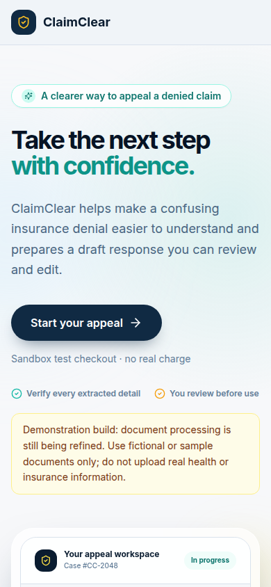
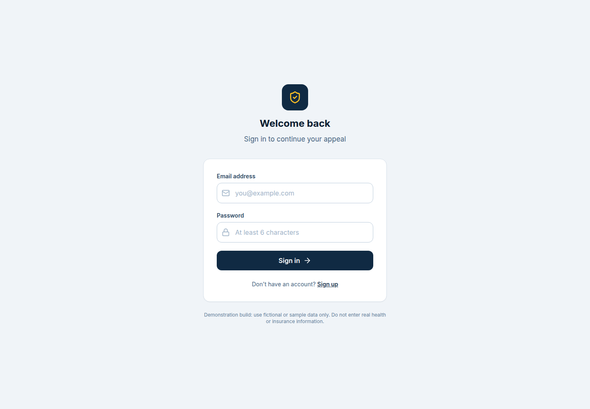

<div align="center">

# ClaimClear

### Turn a confusing denial notice into a clearer, reviewable next step.

ClaimClear is a guided **health-insurance appeal document-preparation demo**. It helps people organize details from a denial notice, check extracted information, answer follow-up questions, and prepare a draft appeal letter for their own review.

[](https://react.dev/)
[](https://www.typescriptlang.org/)
[](https://vite.dev/)
[](https://supabase.com/)
[](#important-demo-limitations)

</div>

> [!CAUTION]
> **Demonstration build — fictional or sample data only. Do not upload or enter real health, insurance, financial, or other personal information.** Document extraction is still being refined. AI-generated information can be missing or incorrect; check every detail before relying on a draft.

> [!IMPORTANT]
> ClaimClear is an assistance and document-preparation tool, not an insurance company, law firm, or medical provider. It does not provide legal or medical advice and cannot guarantee that an appeal will be approved. Payment in this build uses PayPal Sandbox only; **no real payment is processed**.

## Screenshots

### Desktop


### Mobile



<details>
<summary>Sign-in screen</summary>



</details>

## What the demo does

The intended case flow is:

1. **Upload a denial notice.** The demo accepts PDF and common image formats. Use a fictional or sample document only.
2. **Extract and review details.** The intake flow attempts to identify details such as the insurer, claim number, denial code, denial date, patient name, and denied service. Review and correct the results; extraction is not guaranteed to be accurate.
3. **Answer follow-up questions.** If important details are missing, the app can ask for additional information before preparing a draft.
4. **Review an appeal approach.** The server combines confirmed case details with the local denial-code guidance available to the project. Suggestions are informational and may not fit a particular policy or claim.
5. **Use the sandbox checkout.** The current payment integration is for testing only and does not charge real money.
6. **Review and export the letter draft.** After sandbox checkout, the app can prepare a draft for the user to verify, copy, or download as a PDF. The user—not ClaimClear—decides whether and how to send it.

## Product boundaries

ClaimClear helps organize information; it does not determine coverage, interpret a policy authoritatively, make a medical-necessity decision, submit an appeal, or represent a user. Generated text may contain omissions or errors. Users should verify facts, policy terms, appeal instructions, deadlines, attachments, and submission requirements with their insurer or a qualified professional.

This repository is a demonstration, not a production-ready service. In particular, do not use it to process real protected health information (PHI). Uploaded files and case data pass through the configured Supabase project, while document and drafting requests are sent to the configured Gemini API. Review the providers' privacy, retention, and security terms before any non-demo use; this repository does not make a claim about those providers' retention practices.

## Technology

| Area | Implementation |
| --- | --- |
| User interface | React 18, TypeScript, Vite, Tailwind CSS, Lucide icons |
| Client-side state | Zustand |
| Authentication and data | Supabase Auth, Postgres, row-level security (RLS), and Storage |
| Document intake and drafting | Supabase Edge Functions calling the configured Gemini API |
| Checkout | PayPal Sandbox order creation and capture |
| Letter export | PDF generation in the browser |

## Run locally

### Requirements

- Node.js and npm (use a current supported LTS release).
- A Supabase project configured with the schema, RLS policies, storage bucket, and Edge Functions used by this app.
- For end-to-end demo flows: server-side Gemini and PayPal Sandbox credentials. The UI can be explored locally without using real service credentials by using dummy values, but backend functionality will not work until a project is configured.

### 1. Install dependencies

```bash
npm ci
```

### 2. Configure browser-safe variables

Copy the example environment file and enter the URL and **anon** key for your own Supabase project:

```bash
cp .env.example .env
```

Set these Vite variables in `.env`:

| Variable | Purpose |
| --- | --- |
| `VITE_SUPABASE_URL` | Supabase project URL used by the browser client. |
| `VITE_SUPABASE_ANON_KEY` | Supabase anon/public key used by the browser client; access is still controlled by authentication and RLS. |

Never put a Supabase service-role key, Gemini API key, or PayPal client secret in a `VITE_` variable or in browser code. Vite variables are bundled for client-side use.

### 3. Configure Edge Function secrets

Set the backend-only secrets through the Supabase Edge Function secret manager—not in `.env` and not in this repository:

| Secret | Used for |
| --- | --- |
| `SUPABASE_URL` | Server-side Supabase project access. |
| `SUPABASE_ANON_KEY` | Supabase Auth token validation in the functions. |
| `SUPABASE_SERVICE_ROLE_KEY` | Trusted server-side database/storage operations. Treat as highly sensitive. |
| `GEMINI_API_KEY` | Document extraction and appeal-draft generation. |
| `PAYPAL_CLIENT_ID` | PayPal Sandbox checkout. |
| `PAYPAL_CLIENT_SECRET` | PayPal Sandbox order/capture verification. Treat as highly sensitive. |

Use PayPal **Sandbox** credentials only. The code in this demo targets the sandbox; do not assume it is configured for live payments.

### 4. Start the development server

```bash
npm run dev
```

Vite prints the local URL. The app expects its Supabase schema, policies, storage bucket, and deployed Edge Functions to be configured for the flows that use them.

## Project structure

```text
src/
  App.tsx                    App routing, auth gating, and payment-return handling
  components/                Landing, upload, review, questions, dashboard, and letter UI
  lib/auth.tsx               Supabase auth provider and session helpers
  lib/store.ts               Client-side workflow state
  lib/supabase.ts            Supabase client and TypeScript data types
supabase/
  functions/
    upload-denial/           Authenticated document intake and extraction
    case-ops/                Case updates, follow-up, strategy, and letter draft
    paypal-capture/          Sandbox order/capture verification and case update
  migrations/                Database schema, RLS, and case-mutation policies
public/                      Favicon and route manifest
docs/screenshots/             README screenshots captured from the local production build
```

## Database and function deployment notes

The repository includes Supabase migrations and function source. They are **not automatically applied or deployed** by `npm run dev`.

The latest local migration, [`20261110080000_restrict_case_insert_fields.sql`](supabase/migrations/20261110080000_restrict_case_insert_fields.sql), restricts browser-created case rows so clients cannot set payment or workflow state themselves. Before using it, compare the complete migration history with the target Supabase project and review the intended changes. It has not been applied to a remote database as part of preparing this repository.

The local sources for `upload-denial`, `case-ops`, and `paypal-capture` have changed and are marked as needing deployment. Their remote deployment state has not been verified. Reconcile the function versions, secrets, and database migration history in the target project before deploying or applying changes. Do not treat a successful frontend build as evidence that the backend is deployed or operational.

## Quality checks

Run the local checks before submitting changes:

```bash
npm run typecheck
npm run lint
npm run build
```

The current snapshot does not define an automated test suite. These checks validate the frontend code and production bundle; they do not exercise Supabase, Gemini, PayPal, storage permissions, or a real extraction/payment transaction. Lint/build may report non-blocking notices about the installed TypeScript parser's supported version range or stale Browserslist data.

## Security and responsible use

- Use fictional documents; avoid real PHI and personally identifying information.
- Keep service credentials server-side and out of commits, screenshots, browser variables, logs, and support requests.
- Review the Supabase RLS policies and storage policies in the target project; frontend filtering is not a security boundary.
- Treat extracted values, generated strategies, and appeal drafts as unverified. The user must review them.
- Do not describe the app as providing legal, medical, insurance, or coverage advice.
- Do not use the PayPal Sandbox flow as evidence that real payments are supported.

## Licensing

No `LICENSE` file is included. Public visibility on GitHub does not itself grant permission to reuse, redistribute, or modify this project; obtain permission from the project owner unless a license is added.
